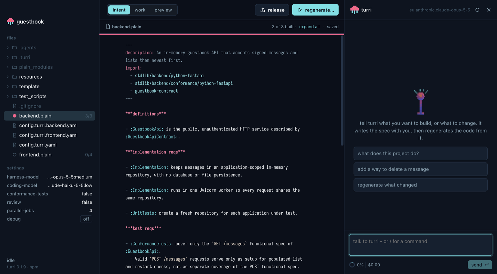

<p align="center"></p>

<h1 align="center">turri desktop</h1>

<p align="center">
  <a href="LICENSE"></a>
  
  <a href="https://www.npmjs.com/package/@turri-dev/cli"></a>
</p>

[**turri**](https://github.com/turri-oss/turri) builds regenerative software: what lasts is the system's intent, and the code is derived from it - cheap to throw away and build again. You tell **turri** what the system should do; **turri** writes that down as durable intent, with the tests that say when it is met, and builds the code from it.

**turri-app** is turri as a desktop app for macOS and Linux, for people who do not live in a terminal. It is not a terminal in a window: it runs turri's own conversation and work loop - the same chat, tools, slash commands, skills and pulses as `turri` on the command line - and shows them in native UI: the spec beside the chat, every pulse live, and the app being built, tried in a browser or a terminal of its own.

<p align="center"></p>

## Quick start

There is no download yet - for now the app runs from source, on macOS or Linux. You need [Node](https://nodejs.org/en/download) 22.19 or newer to build it, and git. On Linux, also a C++ toolchain - the preview's terminal (node-pty) is built for Linux as it installs, where macOS has it ready - and bubblewrap, turri's sandbox there:

```bash
sudo apt install build-essential python3 bubblewrap   # Debian, Ubuntu; dnf install gcc-c++ make python3 bubblewrap on Fedora
```

```bash
git clone git@github.com:turri-oss/turri-app.git && cd turri-app
npm install
npm start
```

turri itself comes with it, from npm, and runs on Electron's own Node: nothing else is installed. If npm held back Electron's or esbuild's install scripts, run `npm install-scripts approve electron esbuild` and `npm rebuild`.

To have it as an app - in Applications, the Dock and Finder's Open With - `npm run dist` packages it into `release/`: a `.dmg` and a `.zip` on macOS, an AppImage and a `.deb` on Linux. It is not signed with a Developer ID yet, so macOS asks before opening it the first time: right-click it, then Open.

Then, on the welcome screen, **start a new project** - name its folder, choose its models: Anthropic, OpenAI, Google, Amazon Bedrock or any other pi supports - or **open** a folder that has turri's `config.turri.yaml` in it. Models are reached as in turri: the provider's API key exported in your shell (`ANTHROPIC_API_KEY`, ... - the app reads your login shell's environment as it starts, so it has your keys and PATH even opened from Finder or the Dock), a sign-in from the window - File > Sign In to Model Providers…, with a subscription in your browser or an API key - which is what pi has from a `/login` in turri too, or a cloud account - see turri's [models](https://github.com/turri-oss/turri#models).

Then tell turri what to build:

> a small API where people can register and sign in

## A tour

- **turri**, on the right (⌘J) - the conversation. It writes the spec with you and regenerates the code from it; tool calls show as what they do, pulses as one line each, and turri's questions are docked in the chat as buttons. Type `/` for its commands.
- **files**, on the left - the whole project: each spec with how much of it is built, everything beside it, and the project's settings.
- **intent** (⌘1) - the `.plain` file, coloured by turri's \*\*\*plain grammar, with each functional spec's state beside it: pink when its code is built, cyan when its conformance tests pass too. Click a mark to regenerate that functional spec or test it; **regenerate** (⌘R) asks how much to rebuild.
- **work** (⌘2) - every pulse live: its stage, what its agent is doing, what it cost, and the \*\*\*plain it works on; earlier sessions' pulses from turri's ledger below.
- **preview** (⌘3) - the app you are building, in a browser pane or a terminal in the project's folder. turri tries it there too - opening pages, clicking, running commands - and the window shows you as it does. **release** puts what is built in `dist/` and starts it.
- **Sign in to your models** (File menu, the welcome screen, or `/login` in the chat) - every model provider pi knows, searchable, each connected or not and how: sign in with a subscription in your browser - Claude Pro/Max, ChatGPT, GitHub Copilot - or type an API key. No terminal needed; it is kept where the turri CLI keeps it.
- **Check this machine** (Help menu) - `turri doctor` in the window: bash, git, the OS sandbox, a model provider, and in a project its toolchains and what its testing scripts run - each with what to do about it, and the models asked only when you say. Anything missing is said on the welcome screen and at the foot of the sidebar; a project just started is checked at once, its models asked too.
- A window for each project, native menus and shortcuts, notifications when a pulse lands, turri's dark and light themes.

Shortcuts are written here as on macOS; on Linux Ctrl takes ⌘'s place - Ctrl+J, Ctrl+R - and the preview's terminal copies and pastes with Ctrl+Shift+C and Ctrl+Shift+V, leaving Ctrl+C to the shell.

Every detail: [the window](docs/window.md).

## What is not here yet

- **A download** - the app is packaged (`npm run dist`), but not yet signed and notarised, published, or updating itself.
- **Resuming a conversation** - each project opened starts a new one.
- **turri's terminal panels** - the side panel, `/lineage`'s picker - have no window form yet; the work view takes the side panel's place.
- **Settings as a form** (but for debug's switch); stacks, spec conflicts and start-overs as dialogs.
- **Windows** - the app runs on macOS and Linux.

## Documentation

| | |
| --- | --- |
| [The window](docs/window.md) | everything the window offers, view by view |
| [Development](docs/development.md) | how the app is put together, running it on a turri clone, checking a change |
| [turri](https://github.com/turri-oss/turri#readme) | turri itself: regenerative software, \*\*\*plain, models, skills |

## Licence

turri-app is open source, under the [MIT licence](LICENSE).
